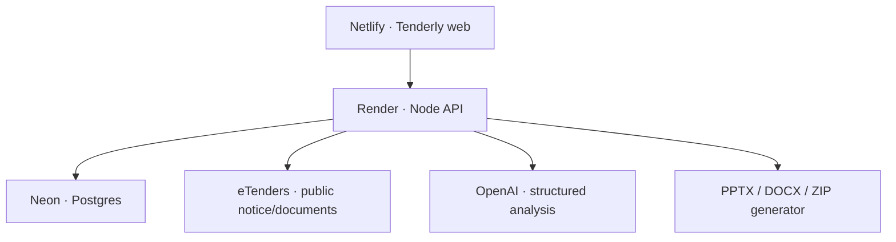

# Tenderly

Tenderly is a tracking-first workspace for Irish public tenders. Its home is a tender board: discover matching opportunities, review the published CFT, track applications and record results. Optional qualification, scoring, evidence-bound drafting and controlled submission tools sit inside each tender.

The most important product rule is deliberate: **Tenderly does not turn missing evidence into a green tick.** Missing or conflicting evidence is `Review`; a final ZIP stays locked until mandatory items are resolved.

## What is implemented

- Named, organisation-scoped CPV boards, each covering one or more recognised CPV families. IT services (`72000000`, including descendants) is the default.
- Persistent tender lifecycle: New, Review, Consider, Application in progress, Done and Ignore; assignee, priority, notes and Won / Not won results. Recording a result closes a tender; reopening clears the old result.
- Board/list views, search, stage/value filters and value swimlanes: up to **EUR 200,000 inclusive**, above EUR 200,000, and value not stated.
- Full tender overview with published scope, deadlines, source fields, document links, public buyer emails, authenticated workspace attachments and source-change history.
- Complete paginated CPV discovery without the old three-day publication window, sixty-detail enrichment cap or fifty-result display cap. Existing CFTs are refreshed without replacing human workflow.
- Public eTenders current-opportunity watcher with low-rate crawling and company-profile matching.
- Open or paste an official eTenders or TED notice link without automatically running AI. Public eTenders documents are imported when available; TED records retain their official published-notice link.
- PDF, DOCX, XLSX, PPTX, ZIP, TXT, CSV, XML and JSON text extraction with bounded ZIP/spreadsheet processing. Legacy `.xls` files are retained but must be converted/exported before text qualification.
- Source-linked AI tender analysis: open/restricted/invited access, framework establishment vs existing-framework mini-competition, fatal eligibility gates, fit score, partner gaps, deadlines, roles, evaluation weights, questions, clarification points and submission rules.
- 1–3 slide `.pptx` synopsis generation.
- Company profile, evidence library and CV/person records in Postgres/Neon.
- Evidence-bound response drafting by Biddy, the built-in bid-writing assistant. Evidence must be explicitly verified before Biddy can use it; missing facts become `[INPUT NEEDED: ...]` rather than invented claims. Drafts answer every part of each scored question in the bidder's voice, prefer specific evidenced examples over boilerplate, and respect stated word limits.
- CV ingestion and sourced role matching: required tender roles are matched against uploaded CV facts, with missing proof left as `Review` and a concrete CV/partner action.
- Human `Reviewed & ready` state for scored answers.
- Tender source-file and completed buyer-template uploads.
- Draft ZIP generation at any time; final ZIP generation is blocked by unresolved eligibility, unanswered required questions, incomplete buyer templates, signatures or pricing items.
- Daily background discovery job and stored match notifications.
- Email/password workspace authentication with bcrypt password hashing and signed 12-hour sessions.
- SSRF protection: arbitrary pasted URLs are not fetched; automatic procurement fetches are restricted to official eTenders hosts.
- Responsive, keyboard-friendly bidder cockpit shared by the Netlify build and the development preview.
- Buyers directory and buyer profiles: every public buyer across tracked and discovered tenders, with their notices and published award intelligence in one place. Buyer names on the board and the tender header link through.
- Market dashboard: active notices, new-this-week and closing-soon counts, CPV division mix, most active buyers, the EUR 200k value split and the eTenders/TED source split — all computed from stored data. Competitor history appears only when the OGP award dataset is loaded (`npm run import:ogp`); until then the panel says so.
- Discovery triage upgrades: match-strength buckets (Strong ≥70, Possible 45–69, Weak <45), per-notice "Not interested" dismissal with Undo, source-checked freshness, value/deadline/procedure/market filters, and CSV export (board export via the API; visible discovery rows exported in the browser).
- Clarifications hub: one date-ordered thread showing direction and manual/portal origin, the official eTenders messaging deep link (sign-in required), and — when the portal connection is linked — sending and syncing buyer messages from the tender. Failures stay on screen; nothing is reported as sent when it was not.
- eTenders portal connection (Beta): connect your own eTenders account in Settings. Credentials are stored AES-256-GCM encrypted, messages are sent as you, and the feature is disabled server-side without `TENDERLY_PORTAL_KEY`.
- EU multi-market scope: discovery preferences choose which countries' notices to watch (TED place of performance), boards can narrow that scope, and non-Irish notices carry market badges.

### Tracking rules and limits

Opening a tender does not change its stage or run paid AI. A matching CPV family is sufficient for intake, even at a zero relevance score. A tender appearing on multiple boards remains one shared record. Removing a board keeps its tenders; at least one board must remain.

Use **Sync tenders** to import open matching notices and refresh tracked eTenders CFTs. The scheduled job follows the same rules. Partial source failures are shown explicitly; they are not reported as a successful complete sync. A source-refresh failure keeps the last saved record, and new listing matches with unavailable details are retained with a verification warning.

Source refresh updates published CFT information and links, not private portal messages or mailbox contents. Record private buyer correspondence in Clarifications; the tool does not send those questions to the buyer. Documents requiring portal authentication must be accessed through the official source or uploaded manually. Workspace source files are not silently replaced by a metadata refresh.

The no-API demonstration is clearly marked and uses synthetic examples; its edits last only for the current page session. Real persistence requires the API and Postgres. Organisation isolation, owner/editor/viewer roles, account export and deletion remain in place. This change does not activate payments, a subscription checkout or deployment.

## Architecture



The browser never talks to Neon or OpenAI directly. Secrets stay on Render.

## Local run

Requirements: Node.js 22+.

### 1. API

```bash
cd server
cp .env.example .env
npm ci
npm run dev
```

For a quick local demo, `DATABASE_URL` and `OPENAI_API_KEY` can be blank. The API then uses in-memory storage and conservative non-AI qualification. For real tender work, configure both.

### 2. Web

In a second terminal from the repository root:

```bash
cp .env.example .env
npm ci
npm run dev
```

Open the local Vite URL. `VITE_API_URL=http://localhost:8787` connects the UI to the API. If `VITE_API_URL` is blank, the UI intentionally runs its built-in demonstration workspace.

## Deploy: Neon → Render → Netlify

### Neon

1. Create a Neon Postgres project/database.
2. Copy its Postgres connection string.
3. Use it as `DATABASE_URL` in **both** Render services in `render.yaml` (web API and cron job).
4. The API applies pending SQL migrations from `server/migrations/` on startup, including `029_tender_boards.sql` for CPV boards. Validate the migration on a staging database before a production rollout.

### Render

This repository includes `render.yaml` for a web API plus a daily discovery cron job.

The discovery job runs at `07:15 UTC` each day (`08:15` in Ireland during summer time). Render cron jobs do not have a free plan, so the Blueprint makes its `starter` plan explicit. If you want to launch at minimum cost, remove the `tenderly-discovery` cron block before creating the Blueprint; manual **Refresh live** discovery in the web app still works.

Required secret values:

- `DATABASE_URL` — Neon connection string.
- `OPENAI_API_KEY` — server-side key used for tender qualification/drafting.

Generated/configured values:

- `JWT_SECRET` — generated by Render for the web service.
- `OPENAI_MODEL` — defaults to `gpt-5.6` and can be changed by environment setting.
- `CORS_ORIGINS` — already set to `https://tenderly.netlify.app`; add future custom domains comma-separated.

Once the web service is healthy, copy its public URL, for example `https://tenderly-api.onrender.com`.

### Netlify

The root `netlify.toml` is ready to use.

1. Connect the repository to Netlify with the repository root as the base.
2. Add `VITE_API_URL=<your Render API URL>` in Netlify environment variables. Do not add a trailing slash.
3. Deploy. The configured publish directory is `dist-netlify`.
4. Point/keep the site at `https://tenderly.netlify.app`.
5. Visit `<Render URL>/health`; it should report `database: configured` and `ai: configured` before using a real bid.

## How a real bid flows

1. **Discover** — Tenderly checks current public opportunities and provides a cheap keyword/CPV fit preview. This is *not* final eligibility.
2. **Import** — open a recommended opportunity or paste its eTenders URL. Tenderly imports the public notice and public documents it can access.
3. **Complete source** — if eTenders requires a signed-in supplier session for a file, download that file yourself and upload it to the Tenderly bid. Tenderly never asks for or stores your eTenders password.
4. **Qualify** — hard gates run before fit scoring. A framework-establishment competition is not treated as closed merely because it says “framework”. Existing-framework mini-competitions require explicit source evidence of restricted membership/invitation.
5. **Synopsis** — review the 1–3 slide brief and download the `.pptx`.
6. **Respond** — scored questions, weights and word limits become response sections. Draft from approved evidence, then explicitly mark each response reviewed/ready.
7. **Assemble** — upload completed buyer templates, pricing schedules and signed files with the `submission` role. Build a draft ZIP whenever useful.
8. **Submit** — final ZIP unlocks only when automated blockers are clear. A human performs the final eTenders upload/submit action.

## Important eTenders boundary

Public opportunity metadata and many tender-document pages are readable without a supplier login, but some documents or submission workspaces can require portal access. Tenderly deliberately does not automate supplier credentials or the final portal submit action. If a source file is not publicly downloadable, the safe path is: download it in your authenticated eTenders session, then upload the file into Tenderly.

The eTenders HTML connector is isolated in `server/src/etenders.ts`. If the portal changes its markup, update this one module and the parser fixtures/tests rather than the bid workflow.

## Safety/readiness rules

- `PASS` requires affirmative bidder evidence plus a tender requirement it actually satisfies.
- Missing bidder data becomes `REVIEW`, not `FAIL` or `PASS`.
- `FAIL` is reserved for an explicit mandatory mismatch.
- “Framework” alone never means “framework members only”.
- AI-generated bid answers start as drafts even when no input is missing; the bidder must mark them ready. Biddy never marks its own work ready, and AI-drafted text keeps its AI-generated provenance label even after human edits.
- Where a tender pack requires disclosure of AI assistance, every Biddy draft and revision carries the declaration duty in its claims-to-verify; where a pack prohibits AI-generated content, generation is refused when no-AI mode is enabled and any earlier drafts are flagged for human rewrite or removal.
- The final ZIP refuses to build while fatal gates are `REVIEW`/`FAIL`, required answers are not ready, or mandatory buyer-file checklist items are incomplete.
- Tenderly prepares the submission package; it does not make the final legal/commercial submission on the bidder's behalf.

## Tests and production builds

API:

```bash
cd server
npm run build
npm test
```

Netlify web build:

```bash
npm run build:netlify
```

The API tests cover eTenders parsing and URL restrictions, document extraction, final-pack blocking, preview scoring, ZIP creation and real PPTX generation.

## Key API routes

- `POST /api/auth/register`, `POST /api/auth/login`
- `GET/PUT /api/company`
- `GET /api/tenders/discover`
- `POST /api/tenders/import`
- `POST /api/tenders/:id/documents`
- `POST /api/tenders/:id/analyse`
- `POST /api/tenders/:id/answers/:questionId/draft`
- `PUT /api/tenders/:id/answers/:questionId`
- `GET /api/tenders/:id/deck`
- `GET /api/tenders/:id/red-team`
- `GET /api/tenders/:id/pack?draft=true|false`
- `GET/POST /api/evidence`, `POST /api/evidence/upload`, `PUT /api/evidence/:id/verification`
- `GET/POST /api/people`, `POST /api/people/upload`
- `GET /api/notifications`

`GET /health` is public and intentionally reports only configuration state, never secret values.
